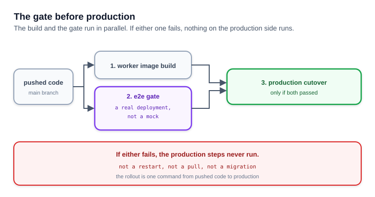
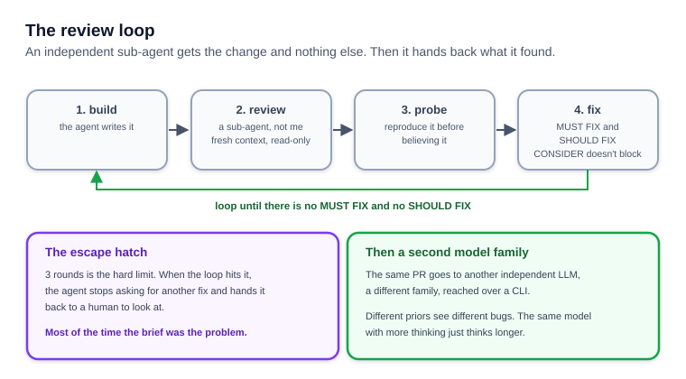
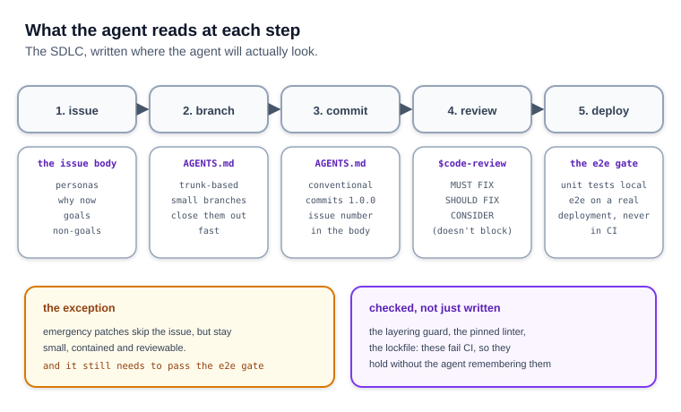
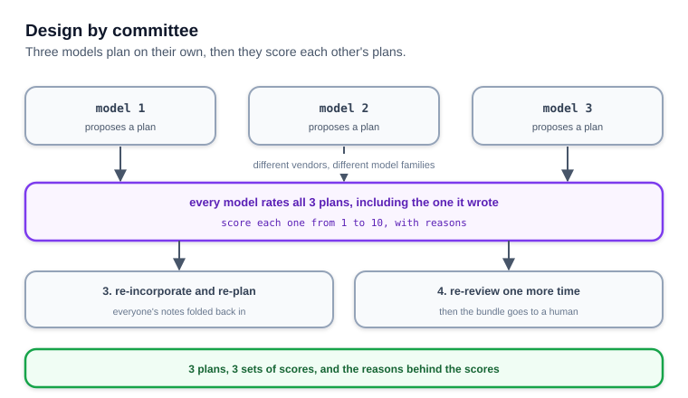

I've seen so much discourse about whether/how far agents can actually take care of "company building" and "agentic development" tasks.  There are new models coming out every week, strong but often unquantified opinions on which tools are the best/needed for agentic development.  So the argument about agentic development often starts with the model: which one writes better code and how much should you trust it? In practice, I've found the more useful question is what happens *after* the code is written: how do you check that it works, catch what it missed, and know when to stop the loop and bring in a person?

...and then there are the stories... Every week you also see stories that seem to point in different directions:
- 1 company says they're shipping 10x more commits than normal
- A study comes out about how [agents only write secure code 25% of the time](https://hackernoon.com/secure-code-benchmark-finds-top-coding-agents-write-secure-code-only-25percent-of-the-time)
- Stories [like my own](https://zeroquarry.com/research/mechquarry-hacked-in-two-hours/) which seem to confirm the previous point
- Studies like [this one](https://securitybrief.com.au/story/ai-coding-benchmarks-show-cheaper-models-can-be-safer), which claim something that feels like the opposite of the 2nd point: that more expensive models produce more vulnerabilities than cheaper models
- Various studies and benchmarks which show that agents are capable of producing cyber attack POCs and finding vulnerabilities in code which seems on the surface counterintuitive to many people compared to the above (if they can find vulnerabilities so well, why can they write code with vulnerabilities)
- Projects where a technology leader says they [completely rewrote Typescript in Rust](https://x.com/theo/status/2107789940482621795?lang=en) over 5 months and the human didn't read a single line of code
- People arguing that [you can't actually understand a large codebase anyway](https://www.seangoedecke.com/in-defense-of-not-understanding-your-codebase/)

If you're seeing these articles come out, the disparity means that you can, in many ways, infer almost anything that you want.  With pejorative terms like "slop" (however well deserved) pushing people into an anti-AI tune or you can choose to believe the pro-AI people, many of which seem to have aggressive arguments about model selection, thinking levels, and sometimes prompts.  My own conversations suggest that a lot of people that are interested in AI in some fashion are getting left out of any meaningful progress because the debates are so rigorous and heated on either side and ignore practical advice for getting started building with AI.

This post will probably become dated quickly, but it's intended to help you get started.

## e2e tests
Probably the first thing to admit is that no person *or* AI writes perfect code, but end-to-end tests are some of the most critical you can set up if you are building with AI because it sets up something the agents can deterministically work against to prove correctness/incorrectness.

In ZeroQuarry, before we ever deploy anything to prod, an e2e test on a staging server runs which:
1. Registers a new account and tests the full e-mail delivery
2. Uses a real e-mail client to ensure the e-mails are actually being delivered
3. Deploys an intentionally vulnerable server and adds an access token that can read a private, vulnerable codebase so ZeroQuarry has something meaningful to scan
4. Uses the API to create and delete projects and create scans. We use a cheap model for creating the scans to keep LLM costs to a pretty insignificant amount; it's meant to test e2e things work functionally. The e2e tests on scans do test for a variety of vulnerabilities to make sure there isn't a detection regression
5. Uses the UI to click around in the app using Playwright + Chromium looking for errors and also that certain elements are present with good values to help prevent UI regressions
6. On every page, it checks whether the documentation linked to [https://docs.zeroquarry.com](https://docs.zeroquarry.com) is live

None of that runs in CI. The e2e tests run against a real deployment on a test server, and they're the thing that has to be green before anything touches production. The worker image build and the gate run in parallel, and if either one fails the production steps never run. Not a restart, not a pull, not a migration.

We've still shipped bugs, but I'd say that the e2e tests have been the biggest class of savior against shipping bugs.  It frequently catches things no unit test catches, the agents know right away when they've broken something a user relies on.  1 thing to know about this is it does drastically increase the time of testing compared to static/unit tests.  The e2e tests regularly take an hour with the LLM-based scans, and that's on top of other CI (linting, unit tests) but if there's one thing I'd encourage people developing with agents to do, it'd be setting up e2e tests no matter the time.

## Agentic reviews
If you're using agents to write code, you'll have more code to review. The first version of our workflow made individual PRs quickly, but too many errors escaped review and surfaced much later. We changed the goal: less human cleanup and better results, even if each PR takes longer.

Some people that are new to agentic development are surprised to hear that you can ask an LLM to review code and it will find bugs *even if it's exactly the same model being asked to review its own code*. I know this doesn't make sense, but it follows on the general theme of LLM-as-a-judge which works well in many places.

### Regular reviews
Before we ship anything, we use a [$code-review](https://github.com/ZeroQuarry/SkillZ/blob/main/code-review/SKILL.md) skill on a loop, but with an independent sub-agent. The idea is that once the code is written, an independent "auditor" (agent) is brought in without the context window history to review the code.  In order to avoid it having the context/history, it's spun up as a sub-agent with *just* the change, and told that it must return `MUST FIX`, `SHOULD FIX`, `CONSIDER` changes and also a final verdict of whether it's been approved (with or without suggestions) or needs changes.

The main context window is told to spin that up as a sub agent, and continue iterating with a `$code-review` sub agent up to 3 times to fix MUST FIX and SHOULD FIX items.  Then, the PR is handed to another independent LLM to have it perform the same type of code review by calling out to another development harness over a CLI.  Most of the time, this results in a clean PR for human review.  But sometimes, as part of a review cycle, it starts becoming clear that the original implementation wasn't sound enough because we start seeing whack-a-mole fixes for example.  In those cases, the "3-review hard limit" makes the agent exit the loop, stop development, and report back to the human that something needs looking at.

The `$code-review` skill almost always catches at least 1 significant problem that would have shipped without review, and often it detects several.

This has made the work slower and more expensive in tokens, which both engineers and leaders should know *will* happen if you're doing agentic development right. A PR for a single issue used to take around 10–30 minutes, but often carried errors that would only be caught later. With the multi-round review loop, a PR now often takes 1 to 2 hours, but arrives in better shape and needs *much* less human intervention. That's a real tradeoff: we're spending more time and inference on each task to reduce the time people spend finding and correcting problems downstream.  If you value human labor time, this is often the right tradeoff, but your humans do need to avoid becoming completely complacent and still do reviews where needed.

It also changes how we organize the work. We run more tasks across multiple machines and isolated worktrees so agents can make progress in parallel without colliding in the same files. That adds coordination overhead, but it lets a small team carry more work through the whole development cycle, with something closer to team-like output than a stream of fast, unfinished PRs.

### Security reviews
ZeroQuarry is, after all, an agentic security review product. So before we merge a PR, it goes through ZeroQuarry. It makes sense from both a reputational and dogfooding perspective (if we had a security breach or if somehow our e2e tests didn't detect a basic problem, it would be a problem for obvious reasons). But the company was started to bring secure development to people that were increasingly developing in an agentic way and also being increasingly attacked by AI agents.  ZeroQuarry supports a diff-based review and it often does find things that regular agentic code reviews don't find.  ZeroQuarry runs before we do a roll-out.

If you want to make sure your own agentically-developed code is secure, [scan your first project for free](https://console.zeroquarry.com/register?utm_source=zeroquarry&utm_medium=research&utm_campaign=agent-development-loops) :). 30 days, 1 private product, no credit card.

### Production monitoring and emergency fixes
The loop we've built doesn't stop at deployment. We also run an AI agent that checks production for major errors and investigates whether they point to a real product defect. When the evidence shows a genuine emergency, it has authority to fix the code and push an emergency patch through our rollout process. The production database remains read-only to the investigation, and the agent doesn't restart services by hand; the patch still goes through the release gate.  That agent has access to production logs, the read-only database access, and Posthog to detect frontend bugs that don't show up in the backend.

For a very small team, this functions a bit like an on-call rotation: production gets watched, failures are investigated against real signals, and a clear emergency can move into a fix without waiting for someone to notice it much later. It doesn't make every anomaly an emergency or every proposed fix safe, so the agent has to distinguish expected behavior from a code defect and stop when the cause or remedy needs a human decision.

### Periodic, bigger structural reviews
An admission that this one is straight up adopted into ZeroQuarry, but as with almost every big repo, they tend to grow and have outdated bits, etc. ZeroQuarry periodically runs a [ponytail audit](https://github.com/DietrichGebert/ponytail/blob/main/skills/ponytail-audit/SKILL.md) across the entire codebase to help keep things tidy. It's not perfect, and a lot of the time the most helpful human intervention is actually steering repository design. But having something at hand to attempt to reduce code is incredibly useful.

## Preparing whoever comes next
When we actually commit, we use PRs with [Conventional Commits](https://www.conventionalcommits.org/en/v1.0.0/) as commit messages.  Conventional commits aren't the only game in town, but they definitely make it easy for both humans and agents to quickly look at "this thing should have docs," "this thing should go out in a marketing announcement," and so on.

I admit we don't update our docs as often as we should, but we do have the ability to and we've even automated the screenshot capture into [https://docs.zeroquarry.com](https://docs.zeroquarry.com) with [https://github.com/ZeroQuarry/zeroquarry-docs/tree/main/scripts/screenshots](https://github.com/ZeroQuarry/zeroquarry-docs/tree/main/scripts/screenshots) which you're welcome to replicate and tailor to your own needs.

A lot of what we've built for work product has been "how do we make sure that the next agent/employee can be productive quickly?" Because if there's one thing I've learned more than anything else in corporate software development at high-growth companies, it's really how you set up your future team for success that matters more than anything.

## Relationship of all of this with SDLC
You probably already have a software development lifecycle (SDLC) whether or not your individual engineers know it. You may have even been required to document it as part of your SOC 2 or ISO 27001 or similar compliance schemes. Those SDLCs are generally quite flexible in the sense that you can kind of say you'll do whatever you want (mostly) but auditors tend to make sure that you're doing what you say.

I think one of the more underappreciated areas of agentic development with respect to compliance is making sure your agents know your SDLC. ZeroQuarry's AGENTS.md outlines specifics:
- How we use issues and how they relate to PRs and how we must have issues before a PR/commit in general
- The exception to the above rule if there is an emergency patch
- How we do trunk-based development
- How we use Conventional Commits and why
- That e2e tests run against a real deployment and never in CI, that unit tests run locally first, and that the agent should think about whether its change is on the path of an e2e test at all
- Which rules are enforced rather than written down: the layering guard, the pinned linter, the lockfile

That last set matters more than it looks. An agent that knows there's a gate clicking through the real app is going to behave differently when it's writing the change than an agent that thinks CI is the whole story.

You'll be able to build functional code without your agents knowing about your SDLC, but adding what you *want* to happen from an SDLC perspective into your AGENTS.md makes it so your agents won't be the cause of your next audit question.

## Design by committee
Often when we're going through initial design phases, I'll use a team of agents operating on different models to do 4 things:
1. Come up with a plan
2. Review all the other agents' plans and score them as well as your own on a scale of 1-10
3. Re-incorporate additions and re-plan
4. Re-review one more time

This probably sounds bonkers to a lot of readers, but it provides a lot of review of bigger items before we start development.  Asking your favorite Anthropic, OpenAI, Gemini, and Chinese models for their best approaches to a solution *will* result in different outputs. Asking them to rate each-others ideas *will* result in them coming to some consensus most of the time, and you can/should review the approaches that boil out.

What's really interesting is that this LLM-as-a-judge and committee design operates far faster and far more effective than many R&D teams I've worked with.

What's next for us here is to start doing actual UI/UX design more by this same committee approach.  Now that most models are vision-capable, they often can identify problems/opportunities, and if you give them each a screenshot or series of them as part of a workflow and say "this is a problem, how would you improve it," we've already noticed that many are able to come up with a plan and then bounce ideas off of the others until they significantly move the needle forward.

## What surprises people
I guess now I'll talk about what I haven't included in this post: nothing about particular models, particular coding harnesses, and limited specific prompts. Do they matter? Yes. But not nearly as much as they get airtime for new(ish) agentic developers.  Some models produce demonstrably worse code than others, but a lot of the quality comes down to "thinking depth" which is controlled not only by selecting a slider in your coding harness but also by forcing thinking depth in structural reviews like this.

Mostly I think it's a waste of time to use local models for software development because even the amount of electricity you end up spending tends to cost more than the inference at a datacenter. There are other reasons to want local models (privacy, etc), but also many providers offer privacy *and* locations that are advantageous *and* cost benefits. The real problem is just that once you get down to the models that most people *can* run because they have the hardware for, you really do end up on the "too dumb to be useful" curve for almost anything beyond small scripts.

Today, ZeroQuarry uses a lot of z.ai GLM 5.3, Kimi K3.1, and MiMo 2.6-pro models for day-to-day development because they're frankly dirt cheap for what you get out of them, even when you use no-logging models through OpenRouter hosted in favorable/local countries.  We use Claude primarily for more design-based tasks. For our committees, we also branch out to OpenAI, Anthropic, Gemini, and other models when we want a more complete picture.  We of course use ZeroQuarry for security scanning.

If you want to see this running rather than described, the adversarial review loop and the AI-surface inventory are in [the product](/platform), and [the research index](/research/) has the rest of it. [Scan your first project for free](https://console.zeroquarry.com/register?utm_source=zeroquarry&utm_medium=research&utm_campaign=agent-development-loops): 30 days, 1 private product, no credit card.
