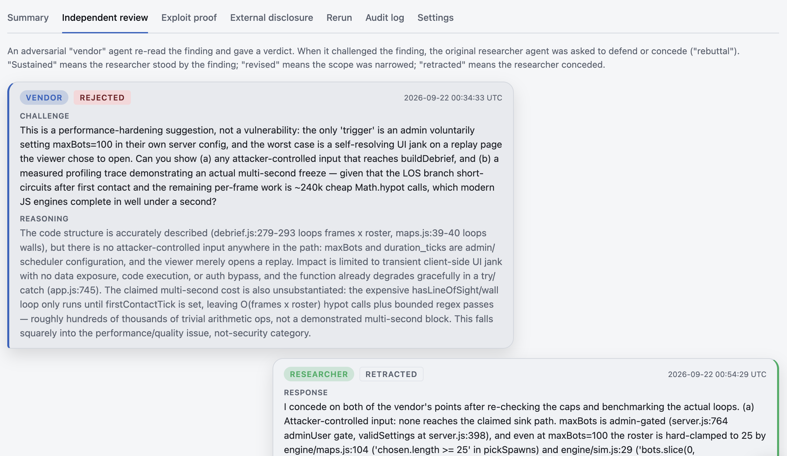
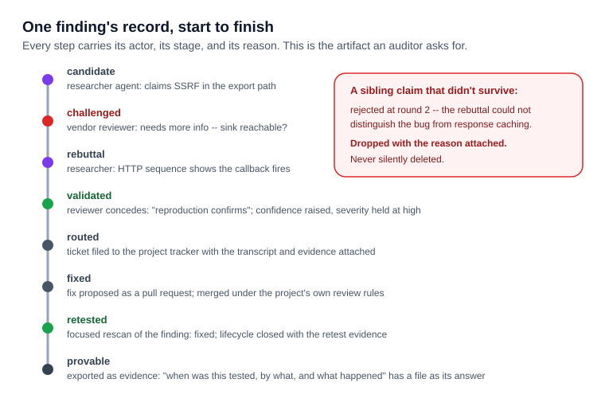

A security scanner that produces security vulnerability "findings" is table stakes in 2026. Every SAST tool, every AI code reviewer, and every pentest-gone-autonomous produces findings. A lot of talk right now is about whether one model/prompt produces some findings, and that *is* very important. But if you ask anyone who has run a triage queue, the real PITA is that their scanners produced eighty-three findings of which six are real and the engineer turns off the scanners because they're too noisy. I spent fifteen years on vulnerability triage teams at Elastic, Kong, and Vectara, and the queue was always a huge pain.

So when we built ZeroQuarry, the design question I cared about most was "how does a finding earn the right to become an engineer's task." What we built was a bounded adversarial loop, and this post explains the mechanism.

## The loop

Every finding starts as a claim built by a "researcher agent" -- an agent whose job is to find a vulnerability as a security researcher. It churns out: what the bug is, where it is, and the evidence -- a proof of concept, an HTTP sequence, sometimes a deployable test package. Then an independent reviewer agent takes the claim, and its objective is inverted: it actively tries to *reject* the assertion that the finding is real the way a vendor's security team would reject a bug report that doesn't reproduce.

If the reviewer is not convinced, the finding comes back as needs-more-info or rejected, and the researcher agent has two moves: repair the claim with better evidence, or concede. Repaired claims go back around and the agents continue having a discussion trying to get the other to concede or give up. (These are bounded with a per-account cap on rounds, because unbounded adversarial loops are how you burn a model budget arguing about HTTP headers. Ask me how I know.) What survives the loop is what ZeroQuarry reports. What doesn't survive is dropped with its reasons attached, never silently deleted (more on why that's a product requirement in a second).

The reviewer is not the researcher with a different system prompt. It runs as a separate stage with its own model selection per stage, it doesn't share the researcher's investigation context, and its success condition is opposite.

## Confidence and severity are different numbers

A finding that survives the loop gets two scores: "severity" is about impact if the thing is real and "confidence" is about how much the evidence supports the claim. Both get updated as the review progresses -- a claim that survived three rounds of attempted rejection carries different confidence than one that sailed through unchallenged, even at identical severity.

The reason this matters is that the two scores route to different work. A "critical" vulnerability with "high confidence" is an engineering ticket today. A "critical" with "low confidence" is *not an engineering ticket yet* -- it's more validation, and paging someone about it is how triage queues lose trust. A "medium" with a working reproduction and a burned rebuttal is often worth more than an unproven "high." Traditional scanners conflate these into one number (usually severity, usually optimistic), and the conflation is precisely what turns "200 findings" into an unusable queue.

## The transcript is part of the deliverable

Every round of the loop is recorded and visible in ZeroQuarry: which model played which role, at which stage, what the challenge was, what the rebuttal was, what changed and why. Months later, when a customer's auditor or your own CTO asks "why was this dismissed?", the answer is on file and not just as a checkbox that got ticked by someone who left the company.

That record is also the product's answer to the question auditors often ask. "When was this tested, by what, and what happened to the results" is a SOC 2 conversation, a customer-mandated scan conversation, *and* an incident postmortem conversation, and it's the same artifact every time: the finding's lifecycle (candidate, validated, disputed, mitigated, retested, regression, accepted-risk, archived) with the actors and reasons attached at each step. Evidence isn't a report you generate at the end; it's the residue the loop leaves behind.

## Closing the loop

Vulnerability detection is, in some ways, becoming a commodity. Unfortunately, reading through noisy not-real findings is the other commodity that comes along with it. But cutting the noise out and using that to help your team prioritize your decisions is the ZeroQuarry product. If you're evaluating any security tool -- ours or anyone's -- the question that sorts vendors faster than any checklist is: what happens to a finding between detection and my engineer's queue, and can you show me the argument?

If you maintain an open-source project, [check a public project free](https://console.zeroquarry.com/register/open-source?utm_source=zeroquarry&utm_medium=research&utm_campaign=the-claim-loop). If you are evaluating software before deploying it, [start a 30-day trial](https://console.zeroquarry.com/register?utm_source=zeroquarry&utm_medium=research&utm_campaign=the-claim-loop) or [get in touch](https://zeroquarry.com/request-scan/?utm_source=zeroquarry&utm_medium=research&utm_campaign=the-claim-loop).
